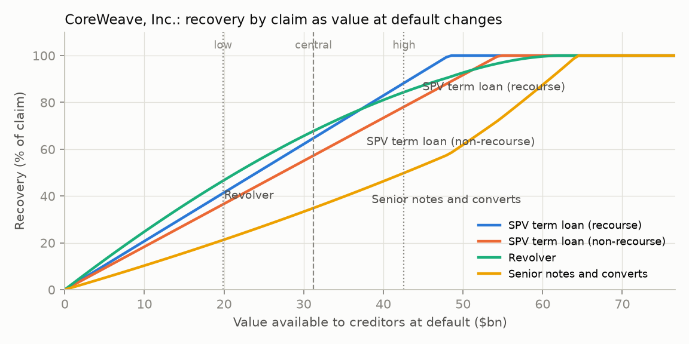
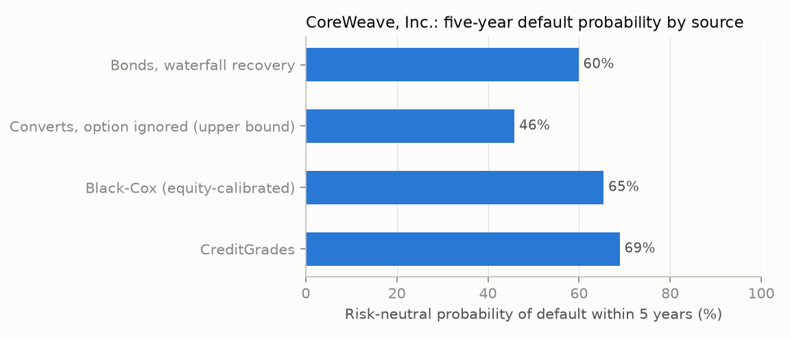

# CoreWeave, Inc. (CRWV)

Balance sheet 2026-09-30 (10-Q, accession 0001769628-26-000465); market data 2026-11-20 close. Amounts in $ millions. Generated by `scripts/make_reports.py`; inputs and their sources are in `cases/coreweave/case.json`.

AI cloud provider financed with SPV delayed-draw term loans secured on GPU fleets and customer contracts, OEM equipment financing, a secured revolver, and parent-level senior notes and convertibles guaranteed by the operating subsidiaries.

## Capital structure

Debt and other claims ranking ahead of equity: **$61,330m** (allowed amounts at default: principal plus six months' interest, revolver 85% drawn). Equity market value $21,973m. Debt-weighted maturity 4.6 years.

| Claim | Obligor | Kind | Allowed claim | Rank | Secured by | Guarantors | Source |
|---|---|---|---|---|---|---|---|
| DDTL 1.0 Facility (SPV, parent-guaranteed) | spv_r | delayed_draw_term_loan | 1,224 | 10 | p_spv_r (lien 1) | parent | Note 10 Debt table |
| DDTL 2.0 Facility (SPV, parent-guaranteed) | spv_r | delayed_draw_term_loan | 2,950 | 10 | p_spv_r (lien 1) | parent | Note 10 Debt table |
| DDTL 2.1 Facility (SPV, parent-guaranteed) | spv_r | delayed_draw_term_loan | 2,606 | 10 | p_spv_r (lien 1) | parent | Note 10 Debt table |
| DDTL 3.0 Facility (SPV, parent-guaranteed) | spv_r | delayed_draw_term_loan | 2,428 | 10 | p_spv_r (lien 1) | parent | Note 10 Debt table |
| DDTL 5.0 Facility (SPV, parent-guaranteed) | spv_r | delayed_draw_term_loan | 2,873 | 10 | p_spv_r (lien 1) | parent | Note 10 Debt table |
| DDTL 5.5 Facility (SPV, parent-guaranteed) | spv_r | delayed_draw_term_loan | 1,641 | 10 | p_spv_r (lien 1) | parent | Note 10 Debt table |
| DDTL 4.0 Facility (CCAC VIII, non-recourse) | spv_nr | delayed_draw_term_loan | 4,743 | 10 | p_spv_nr (lien 1) | - | Note 10 Debt table |
| OEM financing (non-recourse) | oem_nr | equipment_financing | 805 | 10 | p_oem_nr (lien 1) | - | Note 10 Debt table |
| OEM and software financing (recourse) | opco | equipment_financing | 7,236 | 10 | p_oem (lien 1) | parent | Note 10 Debt table |
| Revolving credit facility (85% of $2.5bn commitment drawn at default) | parent | revolver | 2,199 | 10 | p_rcf (lien 1) | opco | Note 10 Revolving Credit Facility |
| 9.25% Senior Notes due 2030 | parent | senior_unsecured | 2,092 | 10 | - | opco | Note 10 Debt table |
| 9.00% Senior Notes due 2031 | parent | senior_unsecured | 1,829 | 10 | - | opco | Note 10 Debt table |
| 9.75% Senior Notes due 2031 | parent | senior_unsecured | 2,884 | 10 | - | opco | Note 10 Debt table |
| 9.625% Senior Notes due 2032 | parent | senior_unsecured | 1,310 | 10 | - | opco | Note 10 Debt table |
| 8.50% EUR Senior Notes due 2032 (EUR 2.0bn) | parent | senior_unsecured | 2,369 | 10 | - | opco | Note 10 Debt table |
| 1.75% Convertible Senior Notes due 2031 | parent | convertible | 2,611 | 10 | - | opco | Note 10 Debt table |
| 1.75% Convertible Senior Notes due 2032 | parent | convertible | 4,035 | 10 | - | opco | Note 10 Debt table |
| 2.875% Convertible Senior Notes due 2033 | parent | convertible | 4,260 | 10 | - | opco | Note 10 Debt table |
| Magnetar loan | parent | other_debt | 195 | 10 | - | - | Note 10 Debt table |
| Accounts payable and accrued liabilities | opco | trade | 8,569 | 10 | - | - | Balance sheet |
| Lease-rejection claims (50% of operating leases rejected) | opco | lease | 2,472 | 10 | - | - | Note 8 lease maturity table |

## Recoveries from the waterfall

Scenario values (enterprise value at default as a share of net PP&E ($56.8bn)): low $19,872m, central $31,228m, high $42,584m.

| Claim | Low | Central | High |
|---|---|---|---|
| DDTL 1.0 Facility (SPV, parent-guaranteed) | 41% | 65% | 88% |
| DDTL 2.0 Facility (SPV, parent-guaranteed) | 41% | 65% | 88% |
| DDTL 2.1 Facility (SPV, parent-guaranteed) | 41% | 65% | 88% |
| DDTL 3.0 Facility (SPV, parent-guaranteed) | 41% | 65% | 88% |
| DDTL 5.0 Facility (SPV, parent-guaranteed) | 41% | 65% | 88% |
| DDTL 5.5 Facility (SPV, parent-guaranteed) | 41% | 65% | 88% |
| DDTL 4.0 Facility (CCAC VIII, non-recourse) | 36% | 57% | 78% |
| OEM financing (non-recourse) | 32% | 50% | 68% |
| OEM and software financing (recourse) | 46% | 67% | 84% |
| Revolving credit facility (85% of $2.5bn commitment drawn at default) | 47% | 68% | 84% |
| 9.25% Senior Notes due 2030 | 21% | 35% | 50% |
| 9.00% Senior Notes due 2031 | 21% | 35% | 50% |
| 9.75% Senior Notes due 2031 | 21% | 35% | 50% |
| 9.625% Senior Notes due 2032 | 21% | 35% | 50% |
| 8.50% EUR Senior Notes due 2032 (EUR 2.0bn) | 21% | 35% | 50% |
| 1.75% Convertible Senior Notes due 2031 | 21% | 35% | 50% |
| 1.75% Convertible Senior Notes due 2032 | 21% | 35% | 50% |
| 2.875% Convertible Senior Notes due 2033 | 21% | 35% | 50% |
| Magnetar loan | 0% | 0% | 0% |
| Accounts payable and accrued liabilities | 21% | 35% | 50% |
| Lease-rejection claims (50% of operating leases rejected) | 21% | 35% | 50% |

Fulcrum (most senior impaired) claim: low: `rcf`, central: `rcf`, high: `ddtl_1_0`

Recoveries used to read default risk from prices: waterfall at the central default-value scenario.

## Bonds: market-implied default risk

| Bond | Clean | Last trade | YTM | Z-spread | Recovery | Hazard | PD 1y | PD 5y | Par-equiv. CDS |
|---|---|---|---|---|---|---|---|---|---|
| 9.25% Senior Notes due 2030 | 82.094 | 2026-11-20 | 16.11% | 1,088bp | 35% | 17.6% | 16% | 59% | 1,137bp |
| 9.00% Senior Notes due 2031 | 78.375 | 2026-11-20 | 16.31% | 1,103bp | 35% | 18.2% | 17% | 60% | 1,176bp |
| 9.75% Senior Notes due 2031 | 77.500 | 2026-11-20 | 16.68% | 1,137bp | 35% | 18.9% | 17% | 61% | 1,220bp |
| 9.625% Senior Notes due 2032 | 76.000 | 2026-11-20 | 16.27% | 1,097bp | 35% | 18.4% | 17% | 60% | 1,191bp |

Residuals against one hazard curve fitted to all the notes (positive = cheap):

| Bond | Market | Curve price | Residual (bp) |
|---|---|---|---|
| 9.25% Senior Notes due 2030 | 82.094 | 81.562 | -21 |
| 9.00% Senior Notes due 2031 | 78.375 | 78.676 | +11 |
| 9.75% Senior Notes due 2031 | 77.500 | 78.246 | +25 |
| 9.625% Senior Notes due 2032 | 76.000 | 75.519 | -15 |

One-year carry and roll-down at unchanged curves, minus the expected default loss at market-implied PDs:

| Bond | Income | Roll-down | Funding | Total | Expected loss | Total minus EL |
|---|---|---|---|---|---|---|
| 9.25% Senior Notes due 2030 | 10.7% | 4.3% | 4.5% | 10.5% | 9.6% | 0.9% |
| 9.00% Senior Notes due 2031 | 11.1% | 4.3% | 4.5% | 10.9% | 9.5% | 1.4% |
| 9.75% Senior Notes due 2031 | 12.4% | 4.2% | 4.5% | 12.1% | 9.6% | 2.5% |
| 9.625% Senior Notes due 2032 | 12.1% | 3.6% | 4.5% | 11.3% | 9.4% | 1.9% |

## Structural models (calibrated to the equity)

Equity $21,973m, volatility 102% (ATM implied volatility, 1-year (listed options)).

| Model | Asset value | Asset vol | PD 1y | PD 5y / to T | Notes |
|---|---|---|---|---|---|
| Merton, KMV default point (1y) | 49,975 | 49% | 20.3% | - | default point $30,665m |
| Merton, all debt due at 4.6y | 42,711 | 71% | - | 80.3% | expected recovery 28% |
| Black-Cox + waterfall | 57,232 | 47% | 22.3% | 65.4% | barrier $30,665m |
| CreditGrades | - | - | 30.4% | 69.0% | 5y CDS-equivalent 1,601bp |

Bond prices from the equity-calibrated Black-Cox model (survival from the asset process, recovery from the waterfall at the barrier):

| Bond | Market | Model | Market minus model |
|---|---|---|---|
| notes_2030 | 82.09 | 73.72 | +8.37 |
| notes_2031a | 78.38 | 71.56 | +6.81 |
| notes_2031b | 77.50 | 72.32 | +5.18 |
| notes_2032 | 76.00 | 71.27 | +4.73 |

## Convertibles

Hazard input: issuer hazard curve fitted to the straight bonds.

| Convert | Market | Last trade | Parity | Bond floor | Model | Implied vol at that hazard | Hazard, option ignored |
|---|---|---|---|---|---|---|---|
| 1.75% Convertible Senior Notes due 2031 | 62.80 | 2026-11-20 | 36.7 | 55.0 | 81.8 | 15% | 12.3% |
| 1.75% Convertible Senior Notes due 2032 | 58.28 | 2026-11-20 | 33.0 | 50.4 | 72.4 | below zero-vol value | 12.4% |
| 2.875% Convertible Senior Notes due 2033 | 64.91 | 2026-11-20 | 40.4 | 51.4 | 80.9 | below zero-vol value | 9.5% |

## Deep puts as default insurance

Tightest bound: 2029-01-19 $5 put, bid 0.72 / ask 1.12 (open interest 4950): risk-neutral default probability by expiry at most **15.9%** (stock worthless at default).

## CDS (22 October 2026 snapshot)

Markit 5Y par spread 1,140.6bp; our converter turns the conventional spread into 19.81 points upfront against Markit's 19.834.

| Bond (BondTerminal 22 Oct) | Price | Par-equivalent CDS | CDS at bond maturity | Basis |
|---|---|---|---|---|
| notes_2030 | 84.35 | 1,027bp | 1,141bp | +114bp |
| notes_2031a | 80.57 | 1,081bp | 1,141bp | +59bp |
| notes_2031b | 80.36 | 1,109bp | 1,141bp | +31bp |
| notes_2032 | 79.25 | 1,074bp | 1,141bp | +66bp |

The CDS curve is a single 5Y point, so the CDS spread at each bond's maturity assumes a flat curve.

## Spread decomposition

Expected loss uses S&P's historical default intensity for B-rated issuers (4.83% defaulted in the December 31, 2022 through December 31, 2025 cohort of 704: 1.65% a year) and the waterfall's central recovery. Spreads are the bonds' par-equivalent CDS spreads, so they compare directly with CDS. Notes' rating: FINRA TRACE security data for the senior notes, queried 2026-11-21.

On 2026-10-22 (the one date with a documented CDS quote, BondTerminal bond marks):

| Bond | Bond spread (CDS-equivalent) | CDS at bond maturity | Expected loss | Default-risk premium | Non-default component |
|---|---|---|---|---|---|
| notes_2030 | 1,027bp | 1,141bp | 107bp | 1,033bp | -114bp |
| notes_2031a | 1,081bp | 1,141bp | 107bp | 1,033bp | -59bp |
| notes_2031b | 1,109bp | 1,141bp | 107bp | 1,033bp | -31bp |
| notes_2032 | 1,074bp | 1,141bp | 107bp | 1,033bp | -66bp |

Expected loss at historical default rates is about a tenth of the default component: the rest is a risk premium, or the market sees this issuer as far riskier than the average issuer with its rating. A negative non-default component means the bonds trade tighter than CDS (a positive basis).

On 2026-11-20 (no CDS quote): the risk premium and the non-default part cannot be separated.

| Bond | Bond spread (CDS-equivalent) | Expected loss | Remainder |
|---|---|---|---|
| 9.25% Senior Notes due 2030 | 1,137bp | 107bp | 1,029bp |
| 9.00% Senior Notes due 2031 | 1,176bp | 107bp | 1,068bp |
| 9.75% Senior Notes due 2031 | 1,220bp | 107bp | 1,113bp |
| 9.625% Senior Notes due 2032 | 1,191bp | 107bp | 1,084bp |

## Example position and scenario P&L

Long $10m face of 9.00% Senior Notes due 2031 at 78.375, plus 11,214 2029-01-19 $5 puts bought at the ask ($1.12; premium $1.26m), sized so an immediate default at the central recovery (35%) costs nothing. Puts are repriced at 118% volatility: the implied volatility of the put's mid quote (sticky strike).

| Scenario | Notes ($m) | Puts ($m) | Total ($m) |
|---|---|---|---|
| Default now, recovery 21% (low) | -5.72 | +4.35 | -1.37 |
| Default now, recovery 35% (central) | -4.35 | +4.35 | +0.00 |
| Default now, recovery 50% (high) | -2.85 | +4.35 | +1.50 |
| Equity -50%, no default | -1.55 | +0.60 | -0.95 |
| Equity +50%, no default | +1.03 | -0.28 | +0.74 |
| One year, nothing changes (coupon only) | +0.90 | -0.69 | +0.21 |

The puts cancel an immediate default at the recovery they were sized for; at other recoveries the position gains or loses the difference. If the equity halves without a default, the notes lose 2.6 times what the puts gain: the hedge covers the jump to default, not the spread widening on the way there.

Caveats: puts bought at the ask, Black-Scholes (European) for the no-default repricing; stock assumed worthless at default (any recovery to equity weakens the hedge); bond financed at no cost (repo and borrow not modelled); last-trade bond price, not an executable quote.

## Missing information

- DDTL 1.0/2.0 spreads and amortization schedules not in Q3 10-Q or FY25 10-K excerpt checked
- Per-instrument CUSIPs (ISINs from baseline only)
- OEM vs software split for recourse tranche
- Revolver pricing
- 2033 convert call/put details only summarised in 10-Q
- Senior note call schedules rely on baseline
- Collateral behind the revolver
- Individual SPV asset values beyond the two aggregates in Note 10
- Call schedules of the senior notes
- Repo / borrow cost for shorting the notes

## Assumptions

- **entity_value_shares** (derived): Value at default spread like book PP&E: SPV debt secured by $22.2bn of non-current assets, of which CCAC VIII $5.2bn (10-Q Note 10); total net PP&E $56.8bn; non-recourse OEM subsidiaries at their financing balance.
- **admin_cost** (convention): Administrative and professional costs, 5% of value (S&P recovery-rating convention (as used in the October 2026 CoreWeave note)).
- **prepetition_interest_months** (convention): Claims = principal + 6 months' interest (S&P recovery-rating convention (as used in the October 2026 CoreWeave note)).
- **revolver_draw_at_default** (convention): Revolver 85% drawn at default (S&P recovery-rating convention (as used in the October 2026 CoreWeave note)).
- **lease_rejection_share** (estimate): Half of operating leases rejected; claims capped by 502(b)(6).
- **default_value_share_of_ppe** (estimate): Low/central/high value at default. Wolfspeed's court-filed liquidation analysis recovered 13.7-44.8% of PP&E book value (fabs); a going concern with assumed customer contracts can be worth more.
- **customer_prepayments** (estimate): Customer contracts ($10.0bn deferred revenue, $132bn RPO) assumed in a restructuring, so prepayments create no claims.
- **undrawn_commitments** (estimate): DDTL 4.0 ($3.9bn) and 5.5 ($1.0bn) undrawn commitments not drawn before default.
