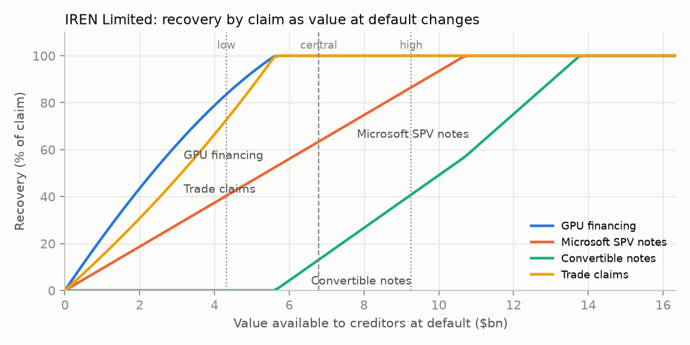
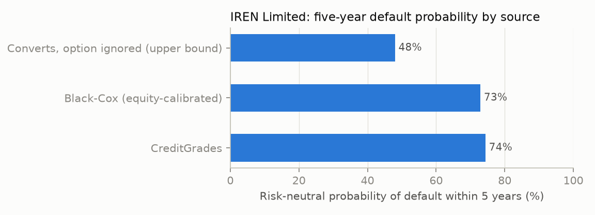

# IREN Limited (IREN)

Balance sheet 2026-09-30 (10-Q, accession 0001878848-26-000066); market data 2026-11-20 close. Amounts in $ millions. Generated by `scripts/make_reports.py`; inputs and their sources are in `cases/iren/case.json`.

Data-center and AI cloud operator: six parent-level convertible issues without subsidiary guarantees, GPU equipment financings and a Microsoft-contract SPV financed by a DDTL and private notes.

## Capital structure

Debt and other claims ranking ahead of equity: **$13,083m** (allowed amounts at default: principal plus six months' interest, revolver 85% drawn). Equity market value $5,016m. Debt-weighted maturity 5.4 years.

| Claim | Obligor | Kind | Allowed claim | Rank | Secured by | Guarantors | Source |
|---|---|---|---|---|---|---|---|
| GPU Financing 2.0 (Mackenzie: MFSA term loan + senior secured notes, single instrument) | ops | term_loan | 990 | 10 | p_gpu2 (lien 1) | parent | Note 19 Debt, GPU Financing 2.0 |
| GPU Financing 3.0 (CA Leasing equipment loans) | ops | equipment_financing | 372 | 10 | p_gpu3 (lien 1) | parent | Note 19 Debt, GPU Financing 3.0 |
| GPU equipment finance leases (24- and 36-month) [lease liability] | ops | equipment_financing | 311 | 10 | p_fl (lien 1) | parent | Balance sheet / Note 17 |
| DDTL Facility (GPU Financing 1.0, Microsoft) | msft_spv | delayed_draw_term_loan | 421 | 10 | p_msft (lien 1) | - | Note 19 Debt |
| 5.96% Senior Secured Notes due 2031 (USPP, Microsoft GPU financing) | msft_spv | secured_notes | 1,618 | 10 | p_msft (lien 1) | - | Note 19 Debt |
| Other recourse debt | ops | other_debt | 14 | 10 | - | - | Note 19 Debt table |
| 3.25% Convertible Senior Notes due 2030 | parent | convertible | 215 | 10 | - | - | Note 19 Debt table |
| 3.50% Convertible Senior Notes due 2029 | parent | convertible | 237 | 10 | - | - | Note 19 Debt table |
| 0.00% Convertible Senior Notes due 2031 | parent | convertible | 1,000 | 10 | - | - | Note 19 Debt table |
| 0.25% Convertible Senior Notes due 2032 | parent | convertible | 1,151 | 10 | - | - | Note 19 Debt table |
| 1.00% Convertible Senior Notes due 2033 (June) | parent | convertible | 1,156 | 10 | - | - | Note 19 Debt table |
| 1.00% Convertible Senior Notes due 2033 (December) | parent | convertible | 3,015 | 10 | - | - | Note 19 Debt table |
| Payables and accruals (incl. $2,493m PP&E payables) | ops | trade | 2,583 | 10 | - | - | Balance sheet |

## Recoveries from the waterfall

Scenario values (share of net PP&E ($12,344m)): low $4,320m, central $6,789m, high $9,258m.

| Claim | Low | Central | High |
|---|---|---|---|
| GPU Financing 2.0 (Mackenzie: MFSA term loan + senior secured notes, single instrument) | 84% | 100% | 100% |
| GPU Financing 3.0 (CA Leasing equipment loans) | 84% | 100% | 100% |
| GPU equipment finance leases (24- and 36-month) [lease liability] | 82% | 100% | 100% |
| DDTL Facility (GPU Financing 1.0, Microsoft) | 40% | 63% | 86% |
| 5.96% Senior Secured Notes due 2031 (USPP, Microsoft GPU financing) | 40% | 63% | 86% |
| Other recourse debt | 73% | 100% | 100% |
| 3.25% Convertible Senior Notes due 2030 | 0% | 13% | 41% |
| 3.50% Convertible Senior Notes due 2029 | 0% | 13% | 41% |
| 0.00% Convertible Senior Notes due 2031 | 0% | 13% | 41% |
| 0.25% Convertible Senior Notes due 2032 | 0% | 13% | 41% |
| 1.00% Convertible Senior Notes due 2033 (June) | 0% | 13% | 41% |
| 1.00% Convertible Senior Notes due 2033 (December) | 0% | 13% | 41% |
| Payables and accruals (incl. $2,493m PP&E payables) | 73% | 100% | 100% |

Fulcrum (most senior impaired) claim: low: `gpu_fin_2`, central: `msft_ddtl`, high: `msft_ddtl`

Recoveries used to read default risk from prices: waterfall at the central default-value scenario.

## Structural models (calibrated to the equity)

Equity $5,016m, volatility 115% (ATM implied volatility, 1-year (listed options)).

| Model | Asset value | Asset vol | PD 1y | PD 5y / to T | Notes |
|---|---|---|---|---|---|
| Merton, KMV default point (1y) | 10,798 | 60% | 27.1% | - | default point $6,542m |
| Merton, all debt due at 5.4y | 7,359 | 94% | - | 89.3% | expected recovery 14% |
| Black-Cox + waterfall | 12,014 | 53% | 30.9% | 72.9% | barrier $6,542m |
| CreditGrades | - | - | 34.8% | 74.4% | 5y CDS-equivalent 1,906bp |

## Convertibles

Hazard input: structural (Black-Cox) first-passage hazard.

| Convert | Market | Last trade | Parity | Bond floor | Model | Implied vol at that hazard | Hazard, option ignored |
|---|---|---|---|---|---|---|---|
| 3.25% Convertible Senior Notes due 2030 | 103.05 | 2026-11-20 | 70.3 | 43.3 | 99.8 | 125% | 0.0% |
| 3.50% Convertible Senior Notes due 2029 | 142.87 | 2026-11-18 | 86.7 | 46.4 | 115.2 | below zero-vol value | 0.0% |
| 0.00% Convertible Senior Notes due 2031 | 48.48 | 2026-11-19 | 13.8 | 31.8 | 41.2 | below zero-vol value | 13.7% |
| 0.25% Convertible Senior Notes due 2032 | 43.49 | 2026-11-20 | 23.0 | 29.0 | 47.5 | 72% | 13.6% |
| 1.00% Convertible Senior Notes due 2033 (June) | 43.12 | 2026-11-20 | 23.0 | 28.1 | 47.7 | 64% | 12.2% |
| 1.00% Convertible Senior Notes due 2033 (December) | 37.98 | 2026-11-20 | 16.2 | 26.9 | 40.6 | 74% | 13.8% |

## Deep puts as default insurance

Tightest bound: 2028-03-17 $3 put, bid 0.55 / ask 1.05 (open interest 15): risk-neutral default probability by expiry at most **19.5%** (stock worthless at default).

## Missing information

- Contracted lease value $13,957M (not RPO) disclosed separately
- Per-tranche amortization schedules of GPU Financing 1.0 (redacted)
- Split of GPU Financing 2.0 between term loan and notes
- Whether any 2029/2030 converts were converted after 9/30 (trigger met; no disclosure)
- Unfunded USPP/DDTL commitment drawn after 9/30
- Exact capped-call notional surviving
- 10-Q does not restate convert call/put terms (baseline used)
- Accounts payable vs accrued split and capex payables

## Assumptions

- **collateral_ltv** (estimate): GPU financings and the Microsoft SPV debt at 80% of the book value of their collateral (not disclosed).
- **admin_cost** (convention): S&P recovery-rating convention (as used in the October 2026 CoreWeave note).
- **prepetition_interest_months** (convention): S&P recovery-rating convention (as used in the October 2026 CoreWeave note).
- **customer_prepayments** (estimate): $2.5bn Microsoft prepayment: contract assumed, no refund claim.
- **default_value_share_of_ppe** (estimate): As in the CoreWeave case.
