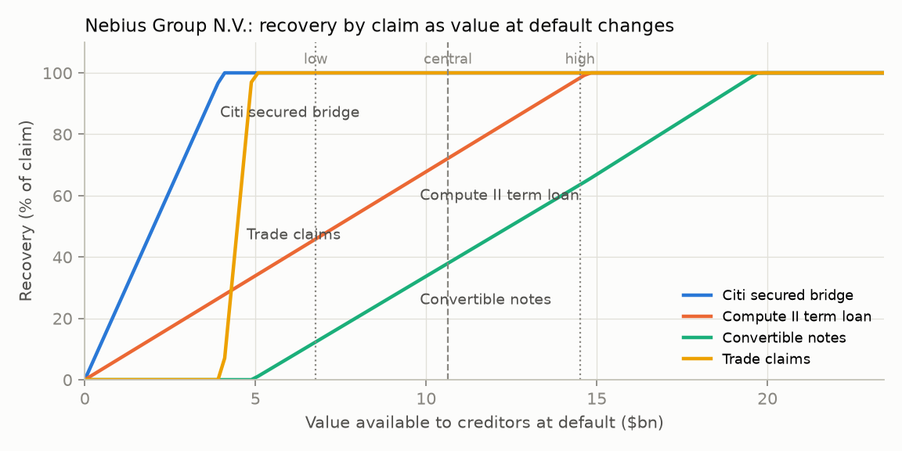
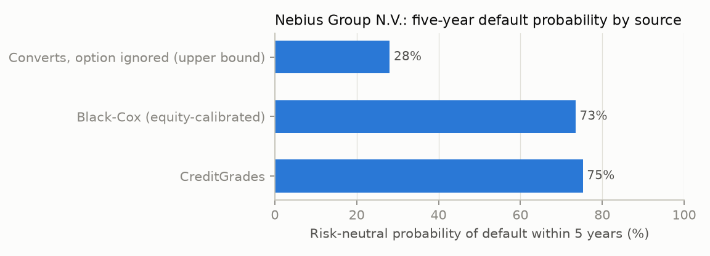

# Nebius Group N.V. (NBIS)

Balance sheet 2026-09-30 (6-K (Ex.99.2 unaudited interim consolidated financial statements; Ex.99.1 operating and financial review), accession 0001104659-26-126238); market data 2026-11-20 close. Amounts in $ millions. Generated by `scripts/make_reports.py`; inputs and their sources are in `cases/nebius/case.json`.

AI cloud provider funded mainly by parent-level convertible notes, with a $3.5bn secured bridge (signed after the quarter) on the operating subsidiaries and an SPV term loan.

## Capital structure

Debt and other claims ranking ahead of equity: **$18,736m** (allowed amounts at default: principal plus six months' interest, revolver 85% drawn). Equity market value $25,529m. Debt-weighted maturity 4.1 years.

| Claim | Obligor | Kind | Allowed claim | Rank | Secured by | Guarantors | Source |
|---|---|---|---|---|---|---|---|
| Citi senior secured bridge ($3.5bn, assumed fully drawn at default) | parent | term_loan | 3,622 | 10 | p_ops (lien 1) | ops | Note 12 Debt |
| Nebius Compute II term loan | compute2 | term_loan | 778 | 10 | p_c2 (lien 1) | - | Note 12 Debt |
| 2.00% Convertible Senior Notes due June 2029 | parent | convertible | 88 | 10 | - | - | Note 12 Debt |
| 3.00% Convertible Senior Notes due June 2031 | parent | convertible | 89 | 10 | - | - | Note 12 Debt |
| 1.00% Convertible Senior Notes due September 2030 | parent | convertible | 1,589 | 10 | - | - | Note 12 Debt |
| 2.75% Convertible Senior Notes due September 2032 | parent | convertible | 1,603 | 10 | - | - | Note 12 Debt |
| 1.25% Convertible Senior Notes due March 2031 | parent | convertible | 2,604 | 10 | - | - | Note 12 Debt |
| 2.625% Convertible Senior Notes due March 2033 | parent | convertible | 1,773 | 10 | - | - | Note 12 Debt |
| 0.50% Convertible Senior Notes due February 2030 | parent | convertible | 3,459 | 10 | - | - | Note 12 Debt |
| 4.50% Convertible Senior Notes due February 2034 | parent | convertible | 2,352 | 10 | - | - | Note 12 Debt |
| Accounts payable, accrued and other liabilities | ops | trade | 779 | 10 | - | - | Balance sheet |

## Recoveries from the waterfall

Scenario values (share of net PP&E ($19,342m)): low $6,770m, central $10,638m, high $14,506m.

| Claim | Low | Central | High |
|---|---|---|---|
| Citi senior secured bridge ($3.5bn, assumed fully drawn at default) | 100% | 100% | 100% |
| Nebius Compute II term loan | 46% | 72% | 98% |
| 2.00% Convertible Senior Notes due June 2029 | 12% | 38% | 64% |
| 3.00% Convertible Senior Notes due June 2031 | 12% | 38% | 64% |
| 1.00% Convertible Senior Notes due September 2030 | 12% | 38% | 64% |
| 2.75% Convertible Senior Notes due September 2032 | 12% | 38% | 64% |
| 1.25% Convertible Senior Notes due March 2031 | 12% | 38% | 64% |
| 2.625% Convertible Senior Notes due March 2033 | 12% | 38% | 64% |
| 0.50% Convertible Senior Notes due February 2030 | 12% | 38% | 64% |
| 4.50% Convertible Senior Notes due February 2034 | 12% | 38% | 64% |
| Accounts payable, accrued and other liabilities | 100% | 100% | 100% |

Fulcrum (most senior impaired) claim: low: `tl_compute2`, central: `tl_compute2`, high: `tl_compute2`

Recoveries used to read default risk from prices: waterfall at the central default-value scenario.

## Structural models (calibrated to the equity)

Equity $25,529m, volatility 111% (ATM implied volatility, 1-year (listed options)).

| Model | Asset value | Asset vol | PD 1y | PD 5y / to T | Notes |
|---|---|---|---|---|---|
| Merton, KMV default point (1y) | 35,748 | 82% | 14.4% | - | default point $11,179m |
| Merton, all debt due at 4.1y | 32,894 | 95% | - | 71.3% | expected recovery 26% |
| Black-Cox + waterfall | 37,480 | 79% | 19.9% | 73.5% | barrier $11,179m |
| CreditGrades | - | - | 20.0% | 75.2% | 5y CDS-equivalent 1,646bp |

## Convertibles

Hazard input: structural (Black-Cox) first-passage hazard.

| Convert | Market | Last trade | Parity | Bond floor | Model | Implied vol at that hazard | Hazard, option ignored |
|---|---|---|---|---|---|---|---|
| 2.00% Convertible Senior Notes due June 2029 | 164.05 | 2026-11-20 | 158.0 | 64.8 | 194.1 | below zero-vol value | 0.0% |
| 3.00% Convertible Senior Notes due June 2031 | 278.00 | 2026-11-09 | 158.0 | 55.0 | 200.0 | below zero-vol value | 0.0% |
| 1.00% Convertible Senior Notes due September 2030 | 94.25 | 2026-11-20 | 58.6 | 53.8 | 100.5 | 75% | 0.0% |
| 2.75% Convertible Senior Notes due September 2032 | 97.21 | 2026-11-18 | 58.6 | 50.0 | 102.6 | 70% | 0.0% |
| 1.25% Convertible Senior Notes due March 2031 | 73.22 | 2026-11-20 | 44.4 | 51.8 | 87.3 | 32% | 7.0% |
| 2.625% Convertible Senior Notes due March 2033 | 69.85 | 2026-11-20 | 45.1 | 48.5 | 89.1 | below zero-vol value | 7.1% |
| 0.50% Convertible Senior Notes due February 2030 | 64.75 | 2026-11-20 | 25.9 | 56.6 | 72.5 | 58% | 18.0% |
| 4.50% Convertible Senior Notes due February 2034 | 62.25 | 2026-11-20 | 25.0 | 51.8 | 74.2 | below zero-vol value | 14.3% |

## Deep puts as default insurance

Tightest bound: 2028-12-15 $15 put, bid 2.01 / ask 5.0 (open interest 6): risk-neutral default probability by expiry at most **14.7%** (stock worthless at default).

## Missing information

- Term Loan undrawn/commitment status
- Citi facility drawn amount
- Maturity table of debt principal
- Restricted cash current/non-current split
- Finance lease liabilities, current operating lease liability
- Shares outstanding after 9/30 (cover figure not extracted) and post-quarter ATM/conversion activity
- Per-series conversion price/accretion tables and CUSIPs re-verified only partly (carried from baseline; conversion rates for Aug/Mar 2026 series confirmed in Note 12)
- Capped calls: none disclosed

## Assumptions

- **compute2_value** (estimate): Compute II asset value = term loan / 0.70 loan-to-value (not disclosed).
- **bridge_drawn_at_default** (estimate): Bridge treated as fully drawn before any default.
- **admin_cost** (convention): S&P recovery-rating convention (as used in the October 2026 CoreWeave note).
- **prepetition_interest_months** (convention): S&P recovery-rating convention (as used in the October 2026 CoreWeave note).
- **customer_prepayments** (estimate): $9.4bn deferred revenue: contracts assumed, no refund claims.
- **leases** (estimate): Lease schedule not extracted; rejection claims omitted (flatters unsecured recoveries).
- **default_value_share_of_ppe** (estimate): As in the CoreWeave case.
