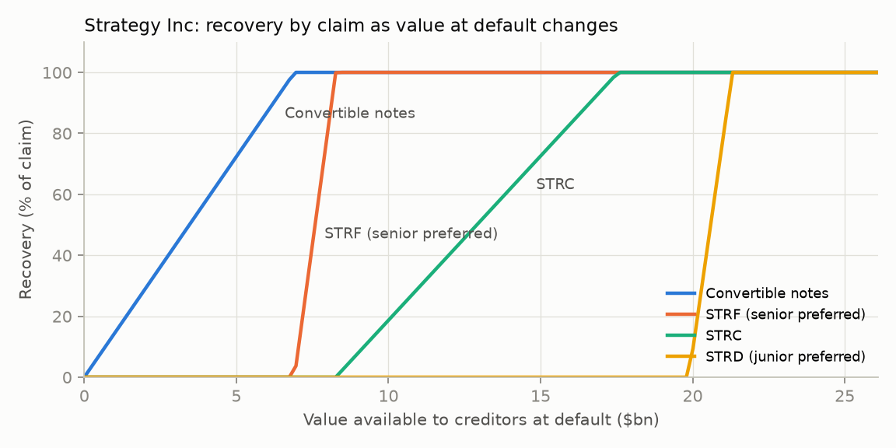
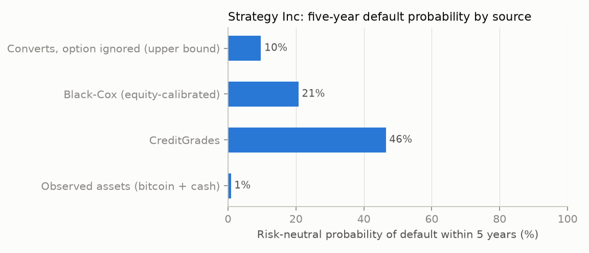

# Strategy Inc (MSTR)

Balance sheet 2026-09-30 (10-Q, accession 0001050446-26-000060); market data 2026-11-20 close. Amounts in $ millions. Generated by `scripts/make_reports.py`; inputs and their sources are in `cases/strategy/case.json`.

Bitcoin treasury company: convertible notes, five perpetual preferred series and common equity backed mainly by 850,849 BTC. Unusual for credit work because the asset value is observable.

## Capital structure

Debt and other claims ranking ahead of equity: **$20,882m** (allowed amounts at default: principal plus six months' interest, revolver 85% drawn). Equity market value $32,859m. Debt-weighted maturity 3.4 years.

| Claim | Obligor | Kind | Allowed claim | Rank | Secured by | Guarantors | Source |
|---|---|---|---|---|---|---|---|
| Secured term loans (non-bitcoin collateral) | parent | term_loan | 41 | 10 | p_nonbtc (lien 1) | - | Note 6 Other long-term secured debt |
| 0.625% Convertible Senior Notes due 2028 | parent | convertible | 1,013 | 10 | - | - | Note 6 Long-term Debt, key terms table and maturities table |
| 0% Convertible Senior Notes due 2029 | parent | convertible | 1,500 | 10 | - | - | Note 6 Long-term Debt, key terms table and maturities table |
| 0.625% Convertible Senior Notes due 2030 (2030A) | parent | convertible | 802 | 10 | - | - | Note 6 Long-term Debt, key terms table and maturities table |
| 0% Convertible Senior Notes due 2030 (2030B) | parent | convertible | 2,000 | 10 | - | - | Note 6 Long-term Debt, key terms table and maturities table |
| 0.875% Convertible Senior Notes due 2031 | parent | convertible | 606 | 10 | - | - | Note 6 Long-term Debt, key terms table and maturities table |
| 2.25% Convertible Senior Notes due 2032 | parent | convertible | 809 | 10 | - | - | Note 6 Long-term Debt, key terms table and maturities table |
| 10.00% Series A Perpetual Strife Preferred | parent | preferred | 1,330 | 30 | - | - | Note 10 Redeemable Preferred Stock, terms table |
| Variable Rate Series A Perpetual Stretch Preferred | parent | preferred | 9,096 | 31 | - | - | Note 10 Redeemable Preferred Stock, terms table |
| 10.00% Series A Perpetual Stream Preferred | parent | preferred | 879 | 32 | - | - | Note 10 Redeemable Preferred Stock, terms table |
| 8.00% Series A Perpetual Strike Preferred | parent | preferred | 1,402 | 33 | - | - | Note 10 Redeemable Preferred Stock, terms table |
| 10.00% Series A Perpetual Stride Preferred | parent | preferred | 1,402 | 34 | - | - | Note 10 Redeemable Preferred Stock, terms table |

## Recoveries from the waterfall

Recoveries used to read default risk from prices: observable-asset model, expected recovery given default within 5 years.

## Structural models (calibrated to the equity)

Equity $32,859m, volatility 88% (ATM implied volatility, 1-year (listed options)).

| Model | Asset value | Asset vol | PD 1y | PD 5y / to T | Notes |
|---|---|---|---|---|---|
| Merton, KMV default point (1y) | 36,114 | 80% | 0.5% | - | default point $3,406m |
| Merton, all debt due at 3.4y | 37,865 | 78% | - | 27.7% | expected recovery 50% |
| Black-Cox + waterfall | 46,738 | 68% | 0.0% | 20.8% | barrier $3,406m |
| CreditGrades | - | - | 1.3% | 46.5% | 5y CDS-equivalent 663bp |

## Convertibles

Hazard input: structural (Black-Cox) first-passage hazard.

| Convert | Market | Last trade | Parity | Bond floor | Model | Implied vol at that hazard | Hazard, option ignored |
|---|---|---|---|---|---|---|---|
| 0.625% Convertible Senior Notes due 2028 | 97.02 | 2026-11-20 | 42.5 | 96.2 | 103.0 | 45% | 0.0% |
| 0% Convertible Senior Notes due 2029 | 88.00 | 2026-11-20 | 11.6 | 92.6 | 93.1 | below zero-vol value | 21.7% |
| 0.625% Convertible Senior Notes due 2030 (2030A) | 97.68 | 2026-11-20 | 51.9 | 91.7 | 103.4 | 49% | 0.0% |
| 0% Convertible Senior Notes due 2030 (2030B) | 89.75 | 2026-11-20 | 17.9 | 93.6 | 94.7 | below zero-vol value | 21.2% |
| 0.875% Convertible Senior Notes due 2031 | 91.55 | 2026-11-20 | 33.4 | 91.9 | 99.5 | below zero-vol value | 5.0% |
| 2.25% Convertible Senior Notes due 2032 | 94.39 | 2026-11-20 | 38.1 | 90.7 | 106.0 | 40% | 0.0% |

## Deep puts as default insurance

Tightest bound: 2028-01-21 $5 put, bid 0.08 / ask 0.33 (open interest 11255): risk-neutral default probability by expiry at most **1.7%** (stock worthless at default).

## Observable assets

Assets $55,555m (850,849 BTC at $58,353 plus cash), volatility 35%, annual dividends and interest $1,602m (2.9% of assets).

| Horizon | Model equity | Market equity | Debt default probability |
|---|---|---|---|
| 1y | 34,014 | 32,859 | 0.00% |
| 5y | 32,417 | 32,859 | 0.86% |
| 10y | 30,587 | 32,859 | 6.59% |

Equity-based calibration against the observed assets:

| Calibration | Implied assets | Error | Implied asset vol | vs observed |
|---|---|---|---|---|
| merton_kmv_1y | 36,114 | -35% | 80% | 2.27x |
| merton_all_debt_5y | 36,787 | -34% | 81% | 2.29x |
| merton_all_claims_5y | 43,052 | -23% | 73% | 2.07x |

| Preferred | Price | Dividend | Current yield | Spread over 30y UST | Model spread (10y) | P(impaired by 10y) | Asset fall to impair |
|---|---|---|---|---|---|---|---|
| STRF | 94.10 | 10% | 10.6% | 5.3% | 0.8% | 9.2% | 88% |
| STRC | 93.60 | 12% | 12.8% | 7.5% | 1.9% | 25.7% | 85% |
| STRK | 58.09 | 8% | 13.8% | 8.5% | 3.2% | 29.4% | 67% |
| STRD (non-cumulative) | 59.82 | 10% | 16.7% | 11.4% | 3.5% | 31.6% | 64% |

## Missing information

- CUSIPs/ISINs for notes and preferreds (not in 10-Q)
- Exact aggregate BTC cost in millions at 11/15 (8-K gives $64.20B rounded)
- Bitcoin pledge/collateral status not verified
- 8-Ks of 10/1, 10/5, 10/13, 10/16, 10/19 and 10/28(8.01) not individually parsed; 10-Q covers through 10/25
- Full preferred certificates of designation (redemption trigger details) not read; only 10-Q summaries
- Lien rank of other secured debt not stated
- STRE (EUR, Luxembourg-listed) price
- Whether any bitcoin is pledged

## Assumptions

- **asset_value** (derived): Bitcoin held (8-K, 15 Nov) x BTC close + cash and short-term investments at 30 Sep. Ignores the software business, taxes and post-quarter cash use.
- **asset_vol** (derived): 1-year realised BTC volatility scaled by bitcoin's share of assets (cash has no volatility).
- **admin_cost** (estimate): Liquidating bitcoin is cheap relative to an operating business; 2% assumed.
- **strc_shares** (derived): STRC shares are the 30 Sep count (90.96m); 8-K repurchases imply about 77.65m by 15 Nov (derived in the filing extract).
