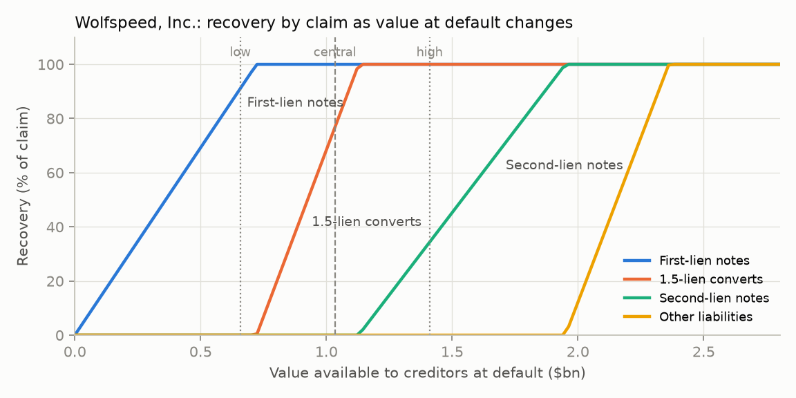
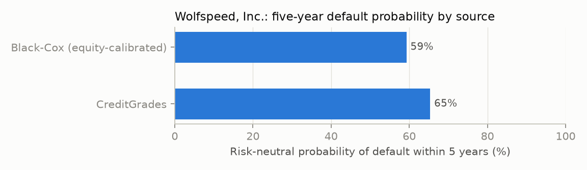

# Wolfspeed, Inc. (WOLF)

Balance sheet 2026-09-27 (10-Q, accession 0000895419-26-000081); market data 2026-11-20 close. Amounts in $ millions. Generated by `scripts/make_reports.py`; inputs and their sources are in `cases/wolfspeed/case.json`.

Silicon-carbide maker that emerged from a prepackaged Chapter 11 in September 2025 with first-lien notes, 1.5-lien and second-lien convertibles and second-lien PIK toggle notes.

## Capital structure

Debt and other claims ranking ahead of equity: **$2,244m** (allowed amounts at default: principal plus six months' interest, revolver 85% drawn). Equity market value $1,030m. Debt-weighted maturity 4.1 years.

| Claim | Obligor | Kind | Allowed claim | Rank | Secured by | Guarantors | Source |
|---|---|---|---|---|---|---|---|
| 15.875% Senior Secured Notes due 2030 (first lien) | parent | secured_notes | 686 | 10 | p_all (lien 1) | - | Note 9 Long-term Debt |
| 3.5% Convertible 1.5-Lien Notes due 2031 | parent | secured_notes | 386 | 10 | p_all (lien 2) | - | Note 9 Long-term Debt / New 1.5L Convertible Notes |
| 7%/12% Second-Lien PIK Toggle Notes due 2031 | parent | second_lien_notes | 314 | 10 | p_all (lien 3) | - | Note 9 Long-term Debt |
| 2.5% Second-Lien Convertible Notes due 2031 (non-Renesas) | parent | second_lien_notes | 260 | 10 | p_all (lien 3) | - | Note 9 Long-term Debt |
| 2.5% Second-Lien Convertible Notes due 2031 (Renesas) | parent | second_lien_notes | 206 | 10 | p_all (lien 3) | - | Note 9 Long-term Debt |
| Other liabilities (payables, accruals, leases) | parent | trade | 391 | 10 | - | - | Balance sheet 9/27/26 |

## Recoveries from the waterfall

Scenario values (share of non-cash assets ($1,880m)): low $658m, central $1,034m, high $1,410m.

| Claim | Low | Central | High |
|---|---|---|---|
| 15.875% Senior Secured Notes due 2030 (first lien) | 91% | 100% | 100% |
| 3.5% Convertible 1.5-Lien Notes due 2031 | 0% | 77% | 100% |
| 7%/12% Second-Lien PIK Toggle Notes due 2031 | 0% | 0% | 34% |
| 2.5% Second-Lien Convertible Notes due 2031 (non-Renesas) | 0% | 0% | 34% |
| 2.5% Second-Lien Convertible Notes due 2031 (Renesas) | 0% | 0% | 34% |
| Other liabilities (payables, accruals, leases) | 0% | 0% | -0% |

Fulcrum (most senior impaired) claim: low: `ssn_2030`, central: `cv_15l_2031`, high: `pik_2l_2031`

Recoveries used to read default risk from prices: waterfall at the central default-value scenario.

## Bonds: market-implied default risk

| Bond | Clean | Last trade | YTM | Z-spread | Recovery | Hazard | PD 1y | PD 5y | Par-equiv. CDS |
|---|---|---|---|---|---|---|---|---|---|
| 15.875% Senior Secured Notes due 2030 (first lien) | 110.000 | 2026-11-20 | 12.33% | 736bp | 95% | not identified | - | - | - |

One-year carry and roll-down at unchanged curves, minus the expected default loss at market-implied PDs:

| Bond | Income | Roll-down | Funding | Total | Expected loss | Total minus EL |
|---|---|---|---|---|---|---|
| 15.875% Senior Secured Notes due 2030 (first lien) | 13.6% | -2.0% | 4.5% | 7.2% | 7.5% | -0.3% |

## Structural models (calibrated to the equity)

Equity $1,030m, volatility 93% (ATM implied volatility, 1-year (listed options)).

| Model | Asset value | Asset vol | PD 1y | PD 5y / to T | Notes |
|---|---|---|---|---|---|
| Merton, KMV default point (1y) | 2,073 | 49% | 13.7% | - | default point $1,122m |
| Merton, all debt due at 4.1y | 2,083 | 61% | - | 69.9% | expected recovery 38% |
| Black-Cox + waterfall | 2,394 | 48% | 14.5% | 59.3% | barrier $1,122m |
| CreditGrades | - | - | 23.9% | 65.4% | 5y CDS-equivalent 1,371bp |

Bond prices from the equity-calibrated Black-Cox model (survival from the asset process, recovery from the waterfall at the barrier):

| Bond | Market | Model | Market minus model |
|---|---|---|---|
| ssn_2030 | 110.00 | 122.91 | -12.91 |

## Convertibles

Hazard input: structural (Black-Cox) first-passage hazard.

| Convert | Market | Last trade | Parity | Bond floor | Model | Implied vol at that hazard | Hazard, option ignored |
|---|---|---|---|---|---|---|---|
| 3.5% Convertible 1.5-Lien Notes due 2031 | 145.14 | 2026-11-17 | 95.4 | 83.5 | 137.9 | 113% | 0.0% |
| 2.5% Second-Lien Convertible Notes due 2031 (non-Renesas) | 194.24 | 2026-11-16 | 157.2 | 41.5 | 169.3 | 251% | 0.0% |
| 2.5% Second-Lien Convertible Notes due 2031 (Renesas) | n/a | - | 104.7 | 41.5 | 126.4 | below zero-vol value | - |

## Deep puts as default insurance

Tightest bound: 2029-01-19 $12.5 put, bid 4.05 / ask 5.2 (open interest 35): risk-neutral default probability by expiry at most **35.8%** (stock worthless at default).

## Missing information

- CUSIPs/ISINs not in filings reviewed
- Whether Renesas Regulatory Approvals were received / Regulatory Trigger Deadline outcome (affects Renesas 16.85M shares vs 0.87M and old-equity 3% vs 5%): not located in the parts of the 10-Q read
- Cash component of Class 3 treatment is derived (277.5 x 1.09875) not stated as one figure; commitment fee amount not captured
- Final Class recovery percentages as filed in the confirmation order not reviewed (DS figures are solicitation-version estimates)
- Claim amounts exclude fees/expenses; General unsecured claims amount not stated
- Debt maturity schedule in 10-Q not read separately (derived from Note 9 table)

## Assumptions

- **admin_cost** (convention): 5% administrative costs; the 2025 liquidation analysis had Chapter 7 costs of 5.2-5.4% of proceeds.
- **lien_ranks** (filed): Intercreditor ranking per instrument names in the 10-Q.
- **default_value_share** (estimate): Share of non-cash assets realised at default.
